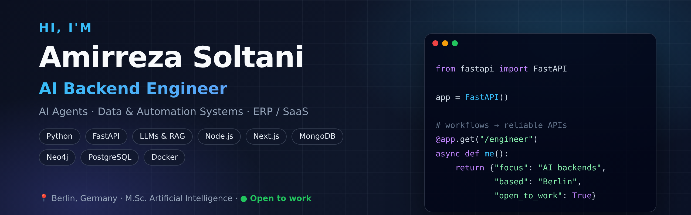

  

# Hi, I'm Amirreza Soltani 👋

### AI Backend Engineer · Data & Automation Systems · ERP / SaaS / AI Agents
📍 Berlin, Germany · 🎓 M.Sc. Artificial Intelligence, SRH University Berlin (2026)

I'm a computer engineer focused on **AI backends, data extraction, ERP-style business systems and Docker-based deployment**. I turn real business workflows into reliable APIs, data models and user-facing tools, and I've built and deployed multiple SaaS and ERP platforms used in production.

🟢 **Open to work:** AI Backend, Backend and Full-Stack Engineer roles in Germany (on-site, hybrid or remote)

---

### 💼 Experience

**AI Backend Engineer (Working Student) · QAVION** · Grünwald, Germany · Aug 2025 – Nov 2025
- Contributed to a company-intelligence **AI Agent** backend that extracts, structures and analyzes public company information
- Built Python/**FastAPI** services, **Pydantic** models, REST endpoints, **MongoDB / Neo4j** data flows, LLM-provider integration, Docker setup and documentation

**IT Manager · Urmia Airport** · Jan 2021 – Dec 2023
- Managed IT support, infrastructure needs and technology coordination in an operational airport environment

---

### 🚀 Production Projects

| Project | What it is | Stack |
|---|---|---|
| **Wholesale Store Management Platform** ([ipekmall.ir](https://ipekmall.ir)) | Full-stack ERP for sales, returns, inventory, purchasing and product catalog. Barcode search, invoicing, **500+ real orders processed** | Next.js · Node.js · MongoDB |
| **Tafel** – Multi-tenant QR Menu SaaS | Restaurant platform: mobile menus, ordering, venue management. Host-based multi-tenancy, plan limits, shared-cart ordering with bill splitting, loyalty ledger, Stripe billing | Laravel · PHP · Filament · PostgreSQL · Redis · Docker |
| **VPNpanel** ([patrickhispeed.com](https://patrickhispeed.com)) | VPN sales and management platform with Telegram bot and Mini App for automated purchasing, payments, config issuance, reseller support and backups | Node.js · TypeScript · Next.js · Docker |
| **Matab** ([drsoltany.ir](https://drsoltany.ir)) | Clinic management system: appointments, electronic visit records, prescriptions, SMS reminders and an integrated AI agent | Full-stack · AI Agent |
| **Personal Offline Email AI Agent** | Privacy-focused, local-first AI assistant for searching, labeling and analyzing personal email | Python · Local LLMs |

### 🧪 Open-Source Projects

| Project | What it does | Stack |
|---|---|---|
| [**Lecture Note AI Agent**](https://github.com/AmirrezaSoltani/lecture-note-Ai-Agent) | Turns recorded lecture audio into structured study notes, exam markers and exportable study material | Python · AI · RQ · Docker |
| [**AI Travel Agent**](https://github.com/AmirrezaSoltani/travel_agent) | AI travel recommendation web app with a production-ready Docker setup | Python · AI · Docker |
| [**CheckHost Bot**](https://github.com/AmirrezaSoltani/checkhostBOt) | Telegram bot that monitors URL/IP reachability and alerts on up/down changes, with a REST API | Node.js · MongoDB · Docker |
| [**Live Data Stream with ML**](https://github.com/AmirrezaSoltani/Simulate-Live-Data-Stream-with-ML) | Real-time weather dashboard for Berlin with PostgreSQL streaming and ML predictions | Flask · Dash · PostgreSQL · ML |
| [**YOLO Object Detector**](https://github.com/AmirrezaSoltani/object-detector) | Real-time object detection and multi-object tracking on video | YOLOv8 · OpenCV · Python |
| [**Payment Invoice Fetcher**](https://github.com/AmirrezaSoltani/Paystar-Invoice-Fetcher) | Payment-gateway invoice sync with token refresh, SOCKS routing and compressed uploads | Node.js |

---

### 🛠 Tech Stack

**AI Engineering:** AI agents · LLM APIs · RAG workflows · prompt/context engineering · information extraction · YOLOv8 · OpenCV  
**Backend:** Python · FastAPI · Pydantic · Flask · Node.js · Express · TypeScript · PHP · Laravel  
**Frontend:** React · Next.js · Tailwind CSS · Filament  
**Data:** MongoDB · Mongoose · Neo4j · PostgreSQL · Redis  
**DevOps & Cloud:** Docker · Docker Compose · Git · AWS S3 · JWT / bcrypt auth  
**Testing:** Jest · Supertest · PHPUnit

---

### 🎓 Education

- **M.Sc. Artificial Intelligence** · SRH University Berlin · 2023 – 2026 (focus: Big Data & AI)
- **B.Sc. Computer Engineering** · Azad University (IAU), Urmia · 2018 – 2022

### 🌍 Languages

English (C1) · Persian (native) · Turkish (B1) · German (A2, learning)

---

### 📫 Let's connect

I'm happy to talk about AI backends, automation, or job opportunities.
